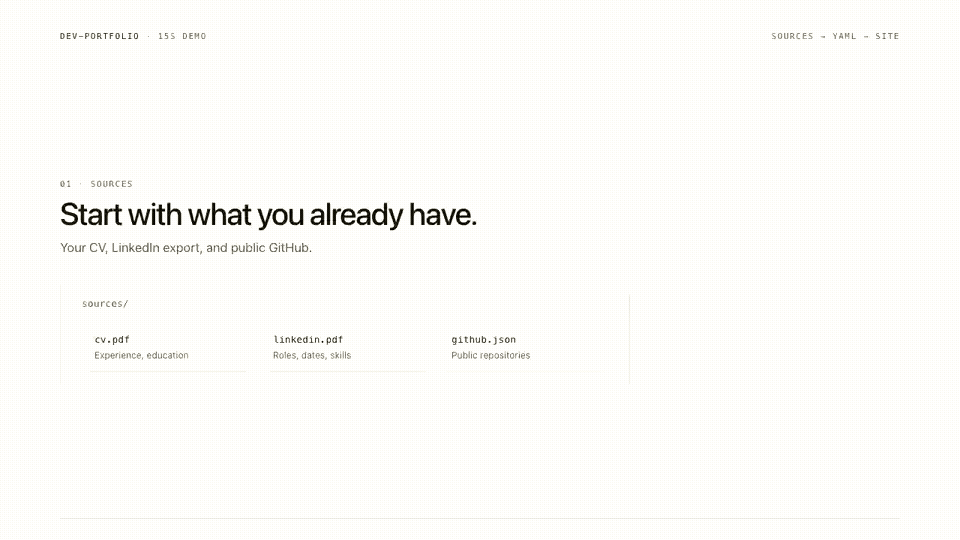

# dev-portfolio

A minimal Next.js personal site where one YAML file holds all content.
Your coding agent can build that YAML from your CV, LinkedIn, and GitHub.

**Demo:** [dev-portfolio-delta-drab.vercel.app](https://dev-portfolio-delta-drab.vercel.app) ·
**Live example:** [yesildal.me](https://yesildal.me) ·
**Sample:** [dev-portfolio-designer.vercel.app](https://dev-portfolio-designer.vercel.app) ·
**Repository:** [github.com/umutyesildal/dev-portfolio](https://github.com/umutyesildal/dev-portfolio)

Next.js 16 · React 19 · Tailwind CSS 4 · TypeScript · Zod · MIT

[](https://skills.sh/umutyesildal/dev-portfolio)
[](https://github.com/umutyesildal/dev-portfolio/releases)



[MP4 version](docs/demo.mp4) · [storyboard](docs/demo.md) · Screenshots:
[home](docs/home.png) · [portfolio](docs/portfolio.png) · [mobile](docs/mobile.jpg)

## What it is

- A real personal site, not a dashboard. Home, experience, selected work, open
  source, and contact.
- One `content/portfolio.yaml` file. No CMS, no database, no build step to learn.
- A source-first agent workflow: drop in a CV, LinkedIn export, and GitHub data,
  then let your coding agent write the YAML.
- Machine-readable by default: `/llms.txt`, Markdown pages, JSON content, JSON
  Schema, and an agent manifest.
- Minimal editorial design: cream paper, ink text, one lime marker.
- Static Next.js, accessible, security headers, and no animation library.

## Quick start

Requirements: Node.js 22.13 or newer and pnpm 11 via Corepack.

```bash
corepack enable
corepack pnpm install
pnpm dev
```

Open [http://localhost:3000](http://localhost:3000).

## Build from your CV, LinkedIn, and GitHub

1. Put your material in `sources/`:
   - `cv.pdf` or `cv.docx`
   - `linkedin.pdf` (LinkedIn → More → Save to PDF) or `linkedin.html`
   - `notes.md` for target roles and anything missing
2. Pull your public GitHub data:

```bash
pnpm profile:github your-username
```

3. Ask your coding agent:

```text
Build my portfolio from sources/. Follow AGENTS.md and
skills/portfolio-builder/SKILL.md. Use only facts present in the sources,
and ask me for anything missing.
```

4. Validate and build:

```bash
pnpm profile:check
pnpm build
```

`sources/` is git-ignored. `profile:check` fails on placeholder text, missing
assets, and `example.com` links. LinkedIn blocks direct scraping; use the
official PDF export or a saved HTML copy.

### Use it as an agent skill

If your agent supports skills.sh:

```bash
npx skills add umutyesildal/dev-portfolio
```

This installs `portfolio-builder`, which knows this repository's source workflow.

## Scripts

| Command | What it does |
| --- | --- |
| `pnpm dev` | Start the local site. |
| `pnpm build` | Production build. |
| `pnpm lint` | ESLint. |
| `pnpm typecheck` | `tsc --noEmit`. |
| `pnpm content:check` | Validate the template YAML and local assets. |
| `pnpm profile:github <user>` | Import public GitHub data into `sources/github.json`. |
| `pnpm profile:check` | Check your own profile for placeholders and missing assets. |
| `pnpm audit --prod --audit-level high` | Production dependency audit. |

## Customize manually

1. Edit `content/portfolio.yaml`, or build it from `sources/`.
2. Add a square portrait of at least 960×960 to `public/`, then point
   `site.avatar` and `socialPreview.avatar` at it.
3. Set `site.url` and `site.repository`, then update
   `public/.well-known/security.txt` and `SECURITY.md`.
4. Run `pnpm content:check`, `pnpm typecheck`, and `pnpm build`.

Every field is documented in [docs/REFERENCE.md](docs/REFERENCE.md).

## Docs

- [Reference](docs/REFERENCE.md): YAML fields, theme tokens, multiple profiles,
  project structure.
- [Agent workflow](docs/AGENT-WORKFLOW.md): prompts for Claude Code, Codex,
  Cursor, and OpenCode.
- [AGENTS.md](AGENTS.md): canonical agent instructions.
- [Content workflow](content/README.md): the short editing guide.
- [Portfolio builder skill](skills/portfolio-builder/SKILL.md): portable agent
  skill for the source workflow.
- [Showcase](docs/SHOWCASE.md): the personal site and a fictional designer
  profile.
- [Launch kit](docs/LAUNCH.md): Vercel Templates, Product Hunt, Show HN, and X
  copy.
- [Changelog](CHANGELOG.md).
- [15-second demo storyboard](docs/demo.md).
- [Roadmap](docs/ROADMAP.md): what is shipped and what comes next.
- [Security policy](SECURITY.md).

## Deploy

[](https://vercel.com/new/clone?repository-url=https://github.com/umutyesildal/dev-portfolio)
[](https://app.netlify.com/start/deploy?repository=https://github.com/umutyesildal/dev-portfolio)

Set `site.url` before deploying. Canonical URLs, the sitemap, robots, and
structured data all read from it.

## Credits

- Original inspiration and portions of the template:
  [Dillion Verma's portfolio](https://github.com/dillionverma/portfolio).
- UI primitives: [shadcn/ui](https://ui.shadcn.com/).
- Framework: [Next.js](https://nextjs.org/) by Vercel.
- Styling: [Tailwind CSS](https://tailwindcss.com/).
- Icons: [Lucide](https://lucide.dev/).
- Markdown: [react-markdown](https://github.com/remarkjs/react-markdown).
- Validation and parsing: [Zod](https://zod.dev/) and
  [YAML](https://eemeli.org/yaml/).
- Typefaces: Instrument Sans and Geist Mono via `next/font/google`.

## License

MIT © 2026 Umut Yunus Yesildal. Portions of this template are derived from
Dillion Verma's portfolio (© 2024 Dillion Verma), used under the MIT License.

The example content in `examples/umut-portfolio.yaml` and `public/examples/` is
personal and excluded from the MIT license. See
[`examples/LICENSE`](examples/LICENSE). Third-party license texts are in
[`THIRD_PARTY_NOTICES.md`](THIRD_PARTY_NOTICES.md).
