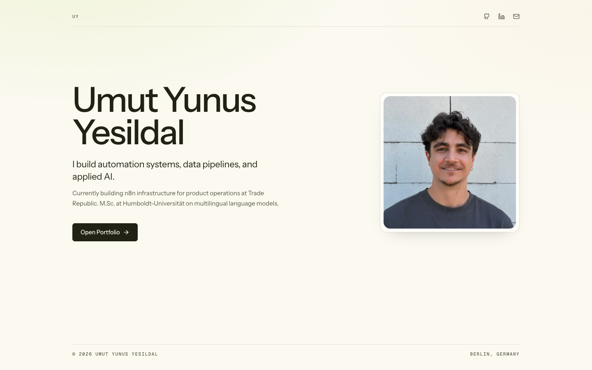
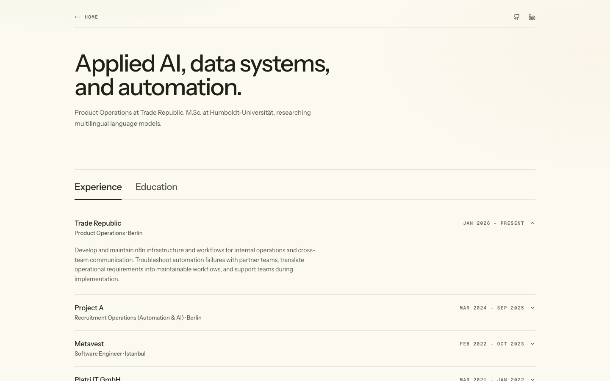
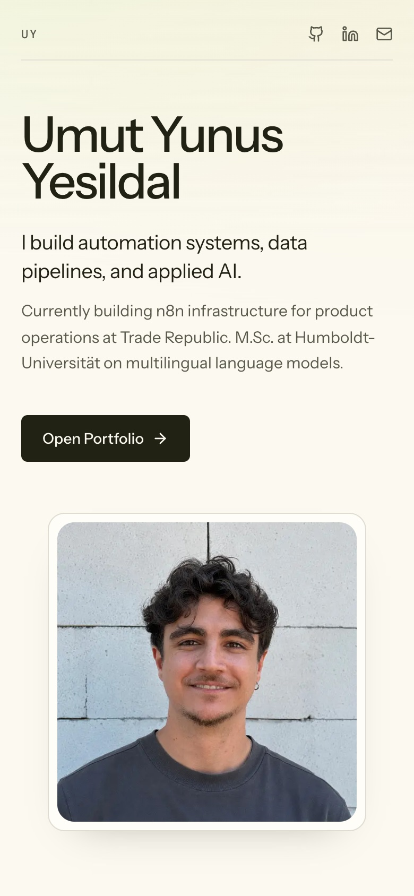

# Agent-ready YAML portfolio

A minimal Next.js portfolio template where one YAML file holds all portfolio
content, and the React layer stays presentation-only.

**Demo:** [dev-portfolio-delta-drab.vercel.app](https://dev-portfolio-delta-drab.vercel.app) ·
**Live example:** [umut.yesildal.me](https://umut.yesildal.me) ·
**Repository:** [github.com/umutyesildal/dev-portfolio](https://github.com/umutyesildal/dev-portfolio)

Next.js 16 · React 19 · Tailwind CSS 4 · TypeScript · Zod · MIT

## Features

- Two routes: a focused landing page (`/`) and a full portfolio (`/portfolio`).
- Every visible portfolio entry and section heading comes from
  `content/portfolio.yaml`.
- Zod validates the YAML on the server; invalid content fails the build with the
  exact path, such as `projects.0.title`.
- Warm editorial theme with cream paper, ink text, and lime used only as a marker,
  defined as CSS tokens. Light mode only, by design.
- Instrument Sans for text and Geist Mono for metadata, loaded with
  `next/font/google`.
- Compact role titles via `shortTitle` and a factual highlight per project via
  `metric`.
- Server-rendered Markdown in project descriptions (`react-markdown`).
- Motion is CSS only, with no animation library and full
  `prefers-reduced-motion` support.
- SEO built in: JSON-LD `Person`, canonical URLs, per-page Open Graph metadata,
  a generated 1200×630 social card, `sitemap.xml`, and `robots.txt`.
- Accessibility defaults: skip link, visible focus rings, semantic landmarks,
  labelled navigation, and decorative icons hidden from assistive tech.
- One codebase, multiple profiles through `PORTFOLIO_CONTENT_FILE`.
- shadcn/ui new-york primitives (Accordion, Button, Badge) and lucide icons.

## Screenshots

| Home | Portfolio |
| --- | --- |
|  |  |



## Quick start

Requirements: Node.js 22.13 or newer (see `.nvmrc`) and pnpm 11 via Corepack.

```bash
corepack enable
corepack pnpm install
pnpm dev
```

Open [http://localhost:3000](http://localhost:3000).

## Customize

1. Edit `content/portfolio.yaml`. It drives all portfolio content and section copy.
2. Add a square portrait of at least 960×960 to `public/`, then point
   `site.avatar` and `socialPreview.avatar` at its root-relative path, such as
   `/portrait.jpg`.
3. Set `site.url` to your real production URL. Canonical links, the sitemap,
   `robots.txt`, and JSON-LD all read from it.
4. Update `socialPreview` for link previews. Its `colors` affect only the
   generated Open Graph image, not the site theme.
5. Validate before deploying:

```bash
pnpm lint
pnpm typecheck
pnpm build
```

### Customize with an AI coding agent

`AGENTS.md` contains the content-mapping rules, safety boundaries, commands, and
definition of done for this template. Attach a CV and use a prompt like:

```text
Customize this portfolio from my attached CV. Follow AGENTS.md, put all personal
content in content/portfolio.yaml, copy approved images into public/, do not
invent facts or links, and finish by running pnpm lint, pnpm typecheck, and
pnpm build.
```

See [agents.md](https://agents.md/) for the open instruction-file format.

## YAML reference

The YAML is validated at build time. Strings marked **optional** may be omitted or
set to `""`; required URL fields must use `https://`, `http://`, `mailto:`, `tel:`,
or a root-relative path. Asset paths must start with `/` and cannot contain `..`.

### `site`

| Key | Required | Description |
| --- | --- | --- |
| `site.name` | Yes | Full name. Used in titles, footer, and JSON-LD. |
| `site.initials` | Yes | Short initials shown in the home header. |
| `site.language` | Yes | Language tag for `<html lang>`, such as `en`. |
| `site.locale` | Yes | Open Graph locale, such as `en_US`. |
| `site.url` | Yes | Absolute production URL. Drives canonical URLs, sitemap, robots, and JSON-LD. |
| `site.location` | Yes | Human-readable location, shown in the footer. |
| `site.locationUrl` | Yes | Map or location link used in the footer. |
| `site.description` | Yes | Default meta description and JSON-LD description. |
| `site.avatar` | Yes | Root-relative portrait path, such as `/portrait.jpg`. Square, at least 960×960. |

### `socialPreview`

| Key | Required | Description |
| --- | --- | --- |
| `socialPreview.title` | Yes | Open Graph and X title. |
| `socialPreview.description` | Yes | Open Graph and X description. |
| `socialPreview.eyebrow` | Yes | Small label on the generated social card. |
| `socialPreview.footer` | Yes | Bottom-left text on the card, usually the domain. |
| `socialPreview.imageAlt` | Yes | Alt text for the social image. |
| `socialPreview.avatar` | Yes | Root-relative image shown on the card. |
| `socialPreview.colors.background` | Yes | Card background, `#RRGGBB`. |
| `socialPreview.colors.card` | Yes | Inner panel color, `#RRGGBB`. |
| `socialPreview.colors.text` | Yes | Primary card text, `#RRGGBB`. |
| `socialPreview.colors.mutedText` | Yes | Secondary card text, `#RRGGBB`. |
| `socialPreview.colors.border` | Yes | Card borders, `#RRGGBB`. |
| `socialPreview.colors.accent` | Yes | Dot accent, `#RRGGBB`. |
| `socialPreview.colors.secondaryAccent` | Yes | Reserved secondary accent, `#RRGGBB`. |

These colors feed only `src/app/opengraph-image.tsx`. The website theme lives in
`src/app/globals.css`.

### `navigation`, `home`, and `notFound`

| Key | Required | Description |
| --- | --- | --- |
| `navigation[].label` | Yes | Link label. |
| `navigation[].href` | Yes | Route or URL. `/` and `/portfolio` get special placement. |
| `home.eyebrow` | Yes | Role summary used as JSON-LD `jobTitle`. Not rendered on the page. |
| `home.headline` | Yes | Main landing-page statement. |
| `home.subheadline` | Yes | Supporting paragraph. |
| `home.featuredSocials` | Yes | List of `contact.socials[].name` values shown as icons in the home header. |
| `home.portfolioCta.label` | Yes | Primary button label. |
| `home.portfolioCta.href` | Yes | Primary button target, usually `/portfolio`. |
| `notFound.code` | Yes | Large status text, such as `"404"`. |
| `notFound.title` | Yes | 404 heading. |
| `notFound.description` | Yes | 404 explanation. |
| `notFound.cta.label` | Yes | Recovery link label. |
| `notFound.cta.href` | Yes | Recovery link target. |

Every name in `home.featuredSocials` must match a `contact.socials[].name`.

### `portfolio`

| Key | Required | Description |
| --- | --- | --- |
| `portfolio.metadataTitle` | Yes | Page title for `/portfolio`. |
| `portfolio.metadataDescription` | Yes | Meta description for `/portfolio`. |
| `portfolio.headline` | Yes | Portfolio page heading. |
| `portfolio.intro` | Yes | Introductory paragraph. |
| `portfolio.headerSocials` | Yes | List of `contact.socials[].name` values for the portfolio header. |
| `portfolio.experience.title` | Yes | Experience section heading. |
| `portfolio.experience.description` | No | Optional section intro. |
| `portfolio.education.title` | Yes | Education section heading. |
| `portfolio.education.description` | No | Optional section intro. |
| `portfolio.projects.title` | Yes | Projects section heading. |
| `portfolio.projects.description` | No | Optional section intro. |
| `portfolio.openSource.title` | Yes | Open-source section heading. Hidden when the list is empty. |
| `portfolio.openSource.description` | No | Optional open-source section intro. |
| `portfolio.earlierProjects.title` | Yes | Earlier-work section heading. |
| `portfolio.earlierProjects.description` | No | Optional section intro. |

### `contact`

| Key | Required | Description |
| --- | --- | --- |
| `contact.email` | Yes | Valid email address. |
| `contact.socials[].name` | Yes | Unique display name, such as `GitHub` or `Email`. Referenced by the home and portfolio header lists. |
| `contact.socials[].url` | Yes | Profile URL, `mailto:`, `tel:`, or root-relative path. |

Names must be unique. Referenced names that do not exist fail validation.

### `work`

| Key | Required | Description |
| --- | --- | --- |
| `work[].company` | Yes | Employer name. |
| `work[].url` | No | Employer website. |
| `work[].location` | No | Role location, such as `Remote` or `Berlin`. |
| `work[].title` | Yes | Full role title. |
| `work[].shortTitle` | No | Compact title used in the collapsed accordion row. Falls back to `title`. |
| `work[].start` | Yes | Start date as a string. |
| `work[].end` | Yes | End date as a string, such as `Present`. |
| `work[].description` | Yes | Responsibilities and outcomes. |

The pair `company` + `title` must be unique.

### `education`

| Key | Required | Description |
| --- | --- | --- |
| `education[].school` | Yes | School or program name. |
| `education[].url` | No | School website. |
| `education[].degree` | Yes | Degree or program. |
| `education[].start` | Yes | Start year or date as a string. |
| `education[].end` | Yes | End year or date as a string. |
| `education[].coursework` | No | List of course names. Defaults to an empty list. |

### `projects`

| Key | Required | Description |
| --- | --- | --- |
| `projects[].title` | Yes | Project name. Must be unique. |
| `projects[].url` | No | Primary project link. Omit or use `""` when private. |
| `projects[].date` | Yes | Display date, such as `"2025"` or `2025–2026`. |
| `projects[].metric` | No | Short factual highlight shown as a marker, such as `3×`, `40%`, or `0.2756 AP`. Leave empty when unverified. |
| `projects[].description` | Yes | Problem, solution, and result. Simple Markdown is supported. |
| `projects[].technologies` | Yes | List of technologies. May be `[]`. |
| `projects[].links[].label` | Yes | Link label, such as `GitHub` or `Demo`. |
| `projects[].links[].url` | Yes | Link target. |
| `projects[].image` | No | Root-relative screenshot, roughly 16:9. Omit or use `""` to hide. |

`links` and `technologies` are arrays but may be empty. `url`, `metric`, and
`image` accept `""`.

Quote numeric-looking dates (`"2025"`) so YAML keeps them as strings. The schema
expects text.

### `openSource`

| Key | Required | Description |
| --- | --- | --- |
| `openSource[].title` | Yes | Repository or project name. |
| `openSource[].description` | Yes | One-line description of what it does. |
| `openSource[].url` | Yes | Repository URL. |
| `openSource[].date` | Yes | Display year as a string. |

The block is hidden when `openSource` is empty.

### `earlierProjects`

| Key | Required | Description |
| --- | --- | --- |
| `earlierProjects[].title` | Yes | Project name. Must be unique. |
| `earlierProjects[].url` | Yes | Project link. |
| `earlierProjects[].date` | Yes | Display date as a string. |
| `earlierProjects[].technologies` | Yes | List of technologies. |

### Date, URL, and asset rules

- Use plain strings for every date. Ranges and labels keep their formatting.
- Only `https`, `http`, `mailto`, `tel`, and root-relative paths are accepted.
- Assets must live under `public/` and be referenced as `/file.ext`.
- Descriptions support simple Markdown such as `**bold text**`.
- Unknown keys are ignored; invalid known fields stop the build with a path.

## Theme and tokens

Tailwind CSS 4 is configured entirely in CSS. There is no `tailwind.config`.

`src/app/globals.css` defines three token tiers:

| Tier | Tokens | Purpose |
| --- | --- | --- |
| Brand seeds | `--cream`, `--paper`, `--ink`, `--ink-soft`, `--rule`, `--lime` | Raw palette. Change these first. |
| Semantic | `--background`, `--foreground`, `--card`, `--primary`, `--muted`, `--border`, `--marker`, and the rest of the shadcn names | Mapped to Tailwind utilities in `@theme inline`. |
| Component and motion | `--radius`, `--measure`, `--ease-*`, `--t-*` | Corners, reading width, and animation timing. |

To retheme, edit the six brand seeds and keep the semantic layer intact. `--lime`
is exposed as `--marker` and is used for underlines, selection, and small accents
only. No dark-mode tokens exist; `src/app/layout.tsx` declares a light color
scheme and a matching `themeColor`.

Fonts live in `src/app/fonts.ts`: Instrument Sans is exposed as
`--font-instrument-sans`, Geist Mono as `--font-geist-mono`. If you swap a font,
keep those variable names or update the `@theme inline` mappings.

If you change the site palette, update `socialPreview.colors` and `themeColor`
separately. The YAML colors do not reach the site CSS.

## Multiple profiles from one repository

By default the site reads `content/portfolio.yaml`. Set
`PORTFOLIO_CONTENT_FILE` to any repository-relative `.yaml` or `.yml` file to
build another profile from the same code:

```bash
PORTFOLIO_CONTENT_FILE=examples/umut-portfolio.yaml pnpm dev
PORTFOLIO_CONTENT_FILE=examples/umut-portfolio.yaml pnpm build
```

The path must stay inside the project directory; absolute paths are rejected.
On Vercel or Netlify, set `PORTFOLIO_CONTENT_FILE` per project for Production,
Preview, and Development. The included CI workflow builds both the default
template and the example profile.

`examples/umut-portfolio.yaml` is a complete real-world example. Its content and
portrait are personal and are **not** MIT licensed. See
[`examples/LICENSE`](examples/LICENSE).

## Project structure

```text
content/portfolio.yaml          Demo content, replace this
examples/
  umut-portfolio.yaml           Full example profile (not MIT)
  LICENSE                       Terms for the example content
public/
  portrait-placeholder.svg      Default portrait
  examples/                     Example portrait assets
src/
  app/
    layout.tsx                  Metadata, JSON-LD, skip link
    page.tsx                    Home route
    portfolio/page.tsx          Portfolio route
    opengraph-image.tsx         Generated 1200×630 social card
    sitemap.ts                  /sitemap.xml
    robots.ts                   /robots.txt
    globals.css                 Tailwind 4 theme and tokens
    fonts.ts                    Instrument Sans + Geist Mono
  components/
    section/                    Experience/education, projects, contact
    ui/                         shadcn/ui primitives
  data/
    schema.ts                   Zod content schema
    portfolio.ts                YAML loader and validation
  lib/utils.ts
AGENTS.md                       Instructions for coding agents
THIRD_PARTY_NOTICES.md          Upstream licenses
```

## Accessibility and SEO defaults

- Skip-to-content link, visible `:focus-visible` rings, and semantic landmarks.
- Accordion built on Radix UI, labelled navigation, portrait alt text, and
  `aria-hidden` decorative icons.
- Reduced motion respected in CSS. Above-the-fold and no-JS content is never
  hidden by animation.
- `metadataBase` comes from `site.url`; both content routes set their own
  canonical URL.
- Per-page Open Graph and X metadata, plus a generated 1200×630 image.
- JSON-LD `Person` with `sameAs`, the first work entry as employer, and education.
- `sitemap.xml` and `robots.txt` generated from the same YAML.
- Security headers: `nosniff`, `DENY` framing, strict-origin referrer policy, and
  a restrictive permissions policy.

Set `site.url` before deploying. Canonical URLs, the sitemap, and structured data
all depend on it.

## Deploy

[](https://vercel.com/new/clone?repository-url=https://github.com/umutyesildal/dev-portfolio)
[](https://app.netlify.com/start/deploy?repository=https://github.com/umutyesildal/dev-portfolio)

Both platforms detect Next.js automatically. No environment variables are needed
for the default profile.

Manual production build:

```bash
pnpm build
pnpm start
```

The build runs `next build` with Turbopack, the default for Next.js 16.

## Credits

- Original inspiration and portions of the template:
  [Dillion Verma's portfolio](https://github.com/dillionverma/portfolio).
- UI primitives: [shadcn/ui](https://ui.shadcn.com/).
- Framework: [Next.js](https://nextjs.org/) by Vercel.
- Styling: [Tailwind CSS](https://tailwindcss.com/).
- Icons: [Lucide](https://lucide.dev/).
- Markdown: [react-markdown](https://github.com/remarkjs/react-markdown).
- Validation and parsing: [Zod](https://zod.dev/) and
  [YAML](https://eemeli.org/yaml/).
- Typefaces: Instrument Sans and Geist Mono via `next/font/google`.

## License

MIT © 2026 Umut Yunus Yesildal. Portions of this template are derived from
Dillion Verma's portfolio (© 2024 Dillion Verma), used under the MIT License.

The example content in `examples/umut-portfolio.yaml` and `public/examples/` is
personal and excluded from the MIT license. See [`examples/LICENSE`](examples/LICENSE).
Third-party license texts are in [`THIRD_PARTY_NOTICES.md`](THIRD_PARTY_NOTICES.md).
