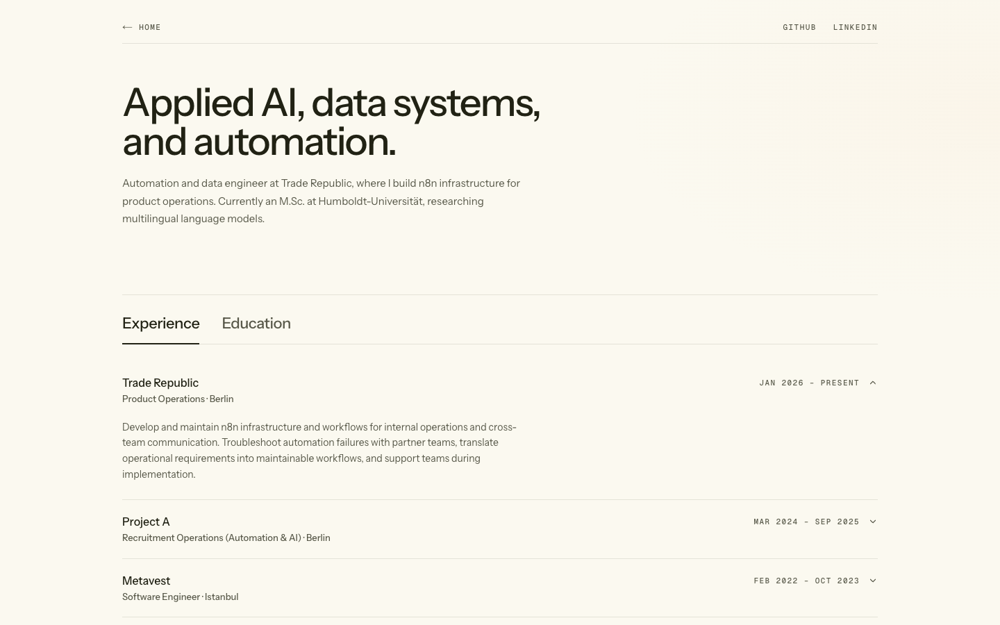
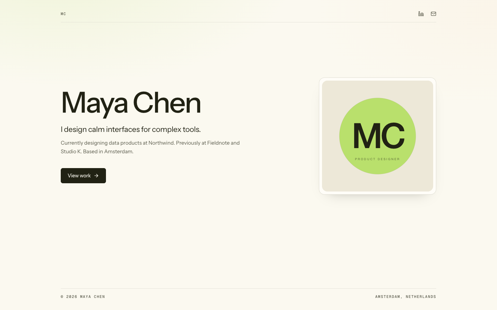
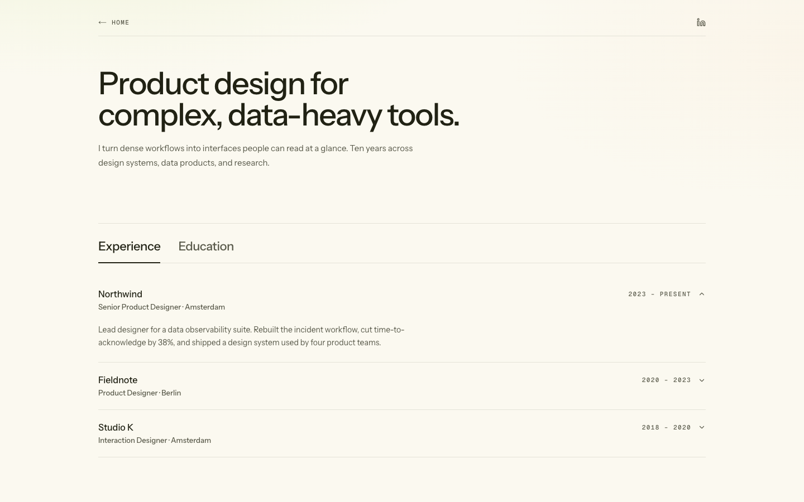

# Showcase

Sites built with `dev-portfolio`. The template is meant to disappear behind the
person using it.

## Personal site

**[yesildal.me](https://yesildal.me)**: Product Operations at Trade Republic.
Automation, data pipelines, and applied AI.



## Fictional sample: Maya Chen

A product designer profile with the same template and a different voice. "Maya
Chen" is not a real person; companies, schools, projects, and metrics are
fictional.

Live: [dev-portfolio-designer.vercel.app](https://dev-portfolio-designer.vercel.app)

Preview locally:

```bash
PORTFOLIO_CONTENT_FILE=examples/sample-designer.yaml pnpm dev
```





## Add yours

Built a site with this template? Open a PR with:

- the live URL,
- one 1440×900 screenshot,
- the role or focus you used it for.
